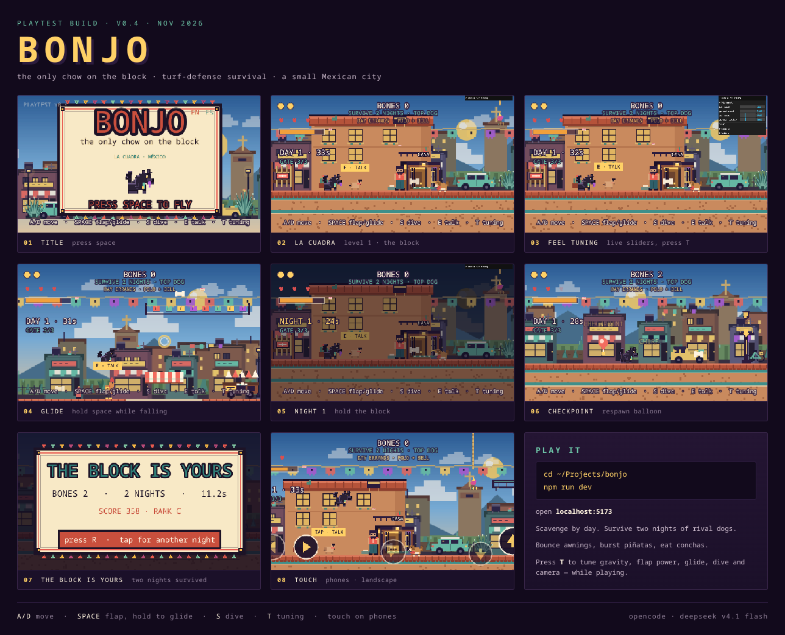
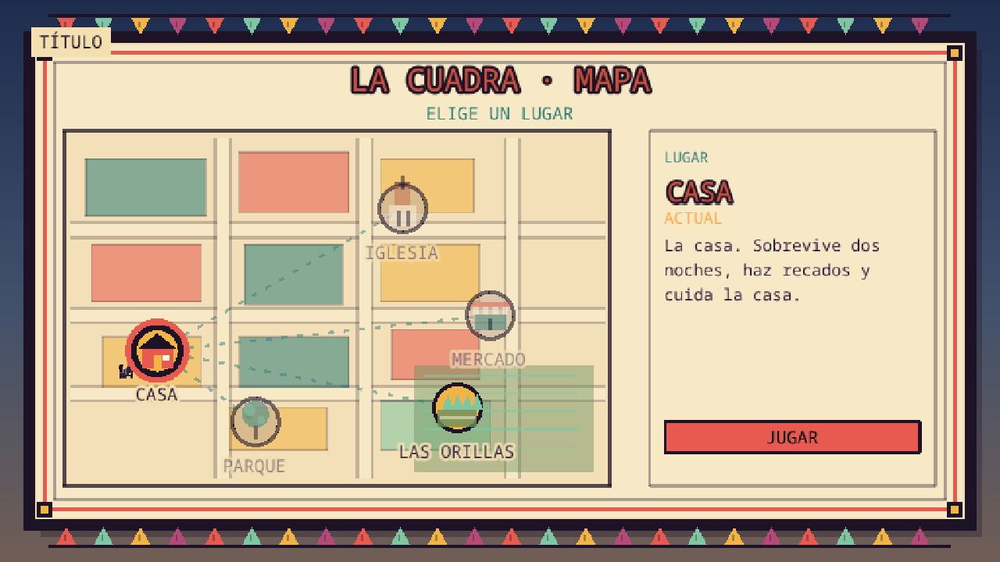
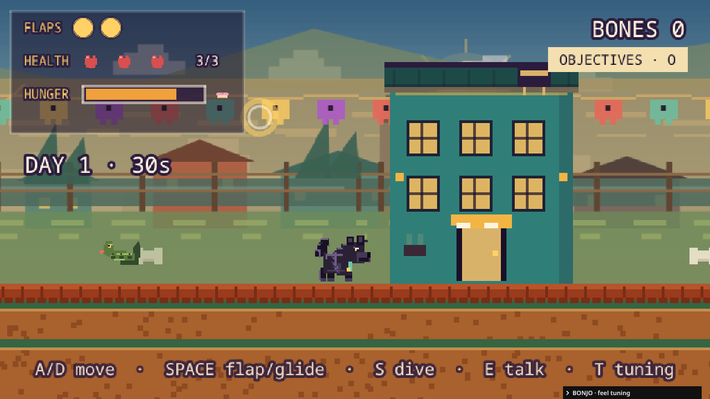
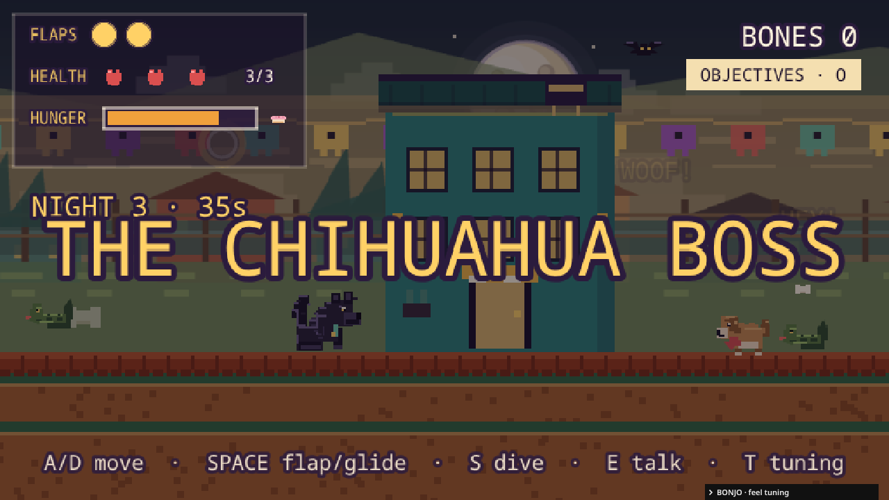

# Bonjo 🐕

**Bonjo is the only chow on the block.** A proud, fluffy black chow who likes
his walks through a small Mexican city — and does not appreciate the neighbor
dogs from other houses trying to take his turf.

A **turf-defense survival platformer**: by day, scavenge the barrio for bones
and conchas; by night, hold the block against waves of rival dogs. Jump, flap,
glide and dive; subdue rivals; bounce off market awnings; knock a piñata for
supplies. Survive two nights and repel the **top dog** in La Cuadra, or three
nights and an aggressive **Chihuahua boss** in Las Orillas.

This is a **playable prototype**, not a finished game. The map hub already has
La Cuadra and Las Orillas playable, with future landmarks plotted for expansion.



Individual 1280×720 screenshots are in [`screenshots/`](screenshots/).
The contact sheet shows the English UI; the game itself now starts in Spanish.







---

## The world

- **Setting:** a small city in México. Level 1, **La Cuadra**, is the urban
  core: flat-roofed houses, a parish church, papel picado, adobe walls and
  terracotta roofs under a clear blue day sky. The fields and blue-green agave
  at the horizon and along the lots are the agricultural edges — **Las
  Orillas** — now playable from the map as a second, field-focused level.
- **Bonjo:** the only chow on the block. Not a killer — he **subdues** his
  rivals by out-jumping them. When beaten, a rival yelps and runs home.
- **Rivals:** dogs from other houses guard their turf, bark (`¡GUAU!`) and
  chase. Dive on one to send it packing. Night waves include **fast** dogs,
  **bone thieves**, **brutes**, and on the final night the **top dog** in La
  Cuadra or the **Chihuahua boss** in Las Orillas.
- **Squirrels & snakes:** small bone thieves. La Cuadra's bushy-tailed
  squirrels become skunks at night; Las Orillas uses snakes day and night.
- **Crows:** one rare aerial pest, plus a far-block crow; they caw when Bonjo gets close.
- **Alley life:** by day, small birds scatter and a rooster crows; in La Cuadra the squirrels and crows give way to skunks and owls at night, while Las Orillas keeps its snakes. Bats cross the dark and the cats keep their watch.
- **Piñatas:** hanging from ropes. Jump, flap or dive into one; each hit drops a
  bone, and the third hit bursts it into a shower of bones.
- **Market awnings:** land on the striped canvas to bounce high and refill your
  flaps. Chain them with the gold rings.
- **High routes:** one-way fire escapes and laundry lines hide bones and
  conchas above the street. Jump up through them and land on top.
- **Foreground houses:** three foreground homes sit on the sidewalk; their
  facades do not block movement, and their rooftops are one-way platforms.
- **Bonjo's roof:** the house roof is a standable one-way platform above the porch.
- **Street life:** taco carts restore hunger, trash cans burst into bones,
  bicycles can be knocked over, and one parked car has an alarm that stuns
  nearby rivals.
- **The porch:** Bonjo's house at the start of the street is a safe zone.
  An open **CASA gateway** and painted threshold mark the line. Normal rivals
  stop there; gate rushers try to chew the gate down. If it breaks, the porch is
  open until dawn. Polo tosses a concha each day, the bell grants another,
  and the chihuahua barks warnings.
- **Survival:** Bonjo has **3 hearts** and a **hunger bar**. Conchas restore
  hunger; an empty bar starts costing health. In La Cuadra, survive two nights
  and repel the top dog; in Las Orillas, survive three and defeat the Chihuahua
  boss. Bones, combo, subdued rivals and no-hit play feed your final score and
  rank.

Tone: cozy, mischievous, non-lethal. The dog wins the block; nobody gets hurt.

---

## Play it

Requires [Node.js](https://nodejs.org/) 18 or newer.

```bash
cd ~/Projects/bonjo
npm install
npm run dev
```

Then open **http://localhost:5173**.

If this project lives on a remote machine (no display), forward the port:

```bash
ssh -L 5173:127.0.0.1:5173 you@your-server
```

…and open `http://localhost:5173` on your own computer.

### Controls

| Key | Ground | Air |
| --- | --- | --- |
| **A / D** or arrows | Run | Steer |
| **SPACE** / **W** | Jump (hold for height) | Flap (2 charges) |
| **Hold SPACE** | — | Glide (slow fall) |
| **S** / **↓** | — | Dive (subdue rivals, pop crows) |
| **E** / touch bubble | Talk to friendly NPCs, ring the bell | — |
| **O** | Open/close objectives | Open/close objectives |
| **T** | Show/hide the tuning panel | |
| **R** | Restart the level | |
| **V** | Toggle the touch buttons | |
| **L** | Switch English / Spanish (title screen) | |
| **Map:** SPACE / ENTER | Play the selected landmark | |
| **Map:** ESC / B | Back to title | |

### Phones and tablets

On a touch device the on-screen controls appear automatically:

- **bottom-left:** ◀ ▶ run (slide between them without lifting)
- **bottom-right:** ▲ flap (hold to glide), ▼ dive
- **bottom-center:** 💬 interact when a friendly NPC or quest object is in range
- **top-right:** the bone counter and **OBJETIVOS / OBJECTIVES** menu; tap the menu to pause and review the goal, errands and what each HUD meter means
- On the **map**, tap a landmark to inspect it, then tap **JUGAR / PLAY**.
- On the end screen, **tap anywhere** to replay; the **MAPA / MAP** button returns to the hub.
- Multi-touch works, so you can run and flap at the same time.
- In portrait, the game pauses behind a **rotate your phone** screen with a
  "play anyway" escape.
- Landscape orientation is strongly recommended.
- **EN / ES** language buttons are in the top-right of the title screen.
- The game starts in **Spanish** by default; choose **EN** for English.

On a desktop you can press **V** to show the touch buttons for testing.

### Interactions in one sentence

Land on a rainbow-striped **awning** to bounce; hit a **piñata** three times to
burst it; **dive** a **rival dog** to make it drop a bone and flee. Eat
**conchas** to keep the hunger bar up. Use taco carts, loot trash cans, knock
over bikes and trip the marked car alarm. Press **E** (or tap the bubble
button) near Polo, the chihuahua, a cat or the daytime rooster to talk; use it
at the bell to ring it. Polo's dialog hands over the daily concha. Survive the
level's nights and final boss; bones, combo and a clean run feed your score and
rank.

---

## The tuning panel (the important part)

Press **T**, or click the `BONJO · feel tuning` bar in the bottom-right.

While playing, drag any slider and *feel* the difference immediately. This is
how platformer game feel is actually designed: change one number, play for ten
seconds, keep or revert.

| Folder | Slider | What it changes |
| --- | --- | --- |
| Movement | run speed | top running speed |
| | ground / air accel | how quickly you reach top speed |
| | ground friction | how quickly you stop |
| Air | gravity | normal falling weight |
| | glide gravity / fall speed | how floaty the glide is |
| | dive gravity / fall speed | how violent the dive is |
| | jump / flap power | height gained per jump / flap |
| | flaps | how many flaps before landing |
| | jump cut | how much a released jump is shortened |
| | min jump hold | minimum time before a jump can be cut |
| | coyote (ms) | grace period to jump after leaving a ledge |
| | jump buffer (ms) | grace period for pressing jump just before landing |
| Camera | look ahead | how far the camera leads your facing direction |
| | camera smoothing | stiff vs. lazy follow |

**Reset defaults** restores everything. The same numbers live in
[`src/tuning.js`](src/tuning.js), heavily commented — copy your favourite values
there to make them permanent.

### Dev playtest helpers (local server only)

- Press **N** to skip to the next day/night phase.
- At the end of a run, copy the `BONJO RUN {...}` line from the browser console
  (or read `localStorage["bonjo.lastRun"]`): time, hearts, hunger, conchas,
  damage taken, falls, waves, nights and bones.
- These helpers are stripped from the production build.

### Starter experiments

- `gravity 1200` → moon dog, much more hang time
- `flap power 500`, `flaps 3` → generous, floaty explorer
- `dive gravity 5000` → aggressive slam, good for stomping rivals and crows
- `jump cut 1.0` → no variable jump height (hold/release stops mattering)
- `coyote 0` and `jump buffer 0` → feel how much those two invisible helpers do

---

## What's in this build

- Run, variable-height jump, coyote time, jump buffering
- Two flaps, glide, dive — each with its own animation pose
- Walk cycle (4-frame), denser 40×40 hero sprite; sits and pants after a short standing beat when idle
- **Health (3 hearts) + hunger bar**, concha pickups, dawn healing
- **Map hub**: a papel-lotería map of La Cuadra with CASA and Las Orillas playable, and Iglesia, Mercado and Parque marked as future routes
- **Las Orillas**: a three-night field level with a continuous floor, farmhouse roofs, agave rows, snakes and an aggressive Chihuahua boss
- **Saved progress**: completed levels and best scores persist in localStorage and show on the map
- **Day/night cycle**: scavenge under the sun, survive waves of rival dogs under the moon
- **Blue-Hour La Cuadra art direction**: limited folk-print palette, lotería-style title/end cards and papel picado trim
- **Ambient wildlife**: day birds, a dawn rooster, alley cats, hooting owls, bats, and a night shift of skunks in La Cuadra or snakes in Las Orillas
- **Objectives panel (O)** for the current goal, Polo/bell errands and a description of each HUD meter
- **Compact labeled status HUD** for health, flap charges and hunger; phase, countdown and gate remain on-screen
- **Rival roles** — fast dogs, bone thieves, brutes, gate rushers, the La Cuadra **top dog** and the Las Orillas **Chihuahua boss**
- **One-way fire escapes and laundry lines** with high bones/conchas
- **Interactive street props** — taco carts, lootable trash, knockable bikes, car alarm stuns
- **Porch gate defense** with gate health and a compromised safe zone if it breaks
- **Named NPC dialog cards**, Polo's daily concha, bell blessing, and chihuahua warnings
- **Scoring**: bone combo, subdued rivals, no-hit and time bonuses; S–D rank on the end screen
- **Squirrels/skunks** in La Cuadra and **snakes** in Las Orillas that steal bones; two crows
- **Piñatas** (3 hits → bones + a concha) and **bouncing market awnings**
- Wind rings that refill flaps mid-air
- Bones, concha food, two checkpoint balloons, a safe **porch**
- La Cuadra: adobe/terracotta town, church, closer storefronts, parked cars, bicycles, papel picado, fields and agave
- Atmospheric haze pushes the city back while keeping Bonjo and the hazards readable
- A longer east block, extra hazards and a second checkpoint
- Fenced level boundaries so Bonjo cannot run off the last platform
- Pits cost a heart and respawn; 0 hearts ends the run
- Camera look-ahead; layered, filtered synthesized SFX with footsteps, landings and animal calls
- **3× internal render resolution** for crisper pixel art without changing the screen layout
- All art generated in code (no image/audio files)
- Keyboard + on-screen touch controls, portrait guard
- **Spanish by default** (La Cuadra, México); toggle **EN / ES** on the title, or press **L**. The choice is remembered.
- Title, top-dog finale, win and game-over screens

**Not in this build:** full menu systems, save slots, gamepad, base upgrades,
crafting, more than two playable levels, real music. (The map hub already lists
future landmarks; the objectives panel pauses play.)

---

## Project map

```
bonjo/
├── index.html              page shell + canvas styling + portrait guard
├── vite.config.js
├── package.json
├── src/
│   ├── main.js             Phaser config (432px tall, width follows aspect)
│   ├── scale.js            SCALE=3 (432px render of a 256×144 design view)
│   ├── tuning.js           EVERY feel number, commented  ← start here
│   ├── art.js              all pixel textures, town, characters, props
│   ├── sfx.js              layered WebAudio sound effects
│   ├── progress.js         saved level completion and best scores
│   ├── levels/
│   │   ├── index.js        ordered landmark/level registry for the map
│   │   ├── laCuadra.js     geometry, spawn, enemies, props and timings
│   │   └── lasOrillas.js   field level config and agricultural theme
│   ├── objects/
│   │   ├── Dog.js          Bonjo's movement + sit/pant + walk cycle
│   │   ├── RivalDog.js     patrol / bark / chase / subdue
│   │   ├── Squirrel.js     patrol, hops, bone thief
│   │   ├── Crow.js         rare aerial hazard
│   │   └── Pinata.js       hanging piñata state + rope
│   ├── ui/
│   │   └── TouchControls.js  on-screen phone buttons + multi-touch + drag
│   └── scenes/
│       ├── Boot.js         builds textures, starts title
│       ├── Title.js        BONJO title screen
│       ├── Map.js          illustrated La Cuadra landmark/level-select hub
│       └── Level1.js       shared level runtime; reads La Cuadra's config
└── dist/                   production build (after `npm run build`)
```

The game renders at a fixed **432px height** (3× the 256×144 design view), with a
width derived from the device's landscape aspect ratio: **768px at 16:9**, up to
**1280px on wide screens** (e.g. 933×432 on a 19.5:9 phone). It re-measures on
rotation or viewport changes, and scenes center and anchor UI from
`this.scale.width`, so the canvas keeps filling the screen instead of
letterboxing with side bars. `pixelArt: true` keeps it crisp.

---

## Build and share

```bash
npm run build
```

This writes static files to `dist/`. You can:

- **itch.io:** zip the *contents* of `dist/`, upload as an HTML5 game, set
  `index.html` as the entry point.
- **Netlify / GitHub Pages / any static host:** upload `dist/`.
- **Locally:** `npm run preview` and open the printed URL.

No special server headers are required (no threads/SharedArrayBuffer).

---

## Swapping the placeholder art

All placeholder art is generated in `src/art.js` so the prototype needs zero
assets. To use real sprites:

1. Put PNGs in `public/assets/`.
2. Load them in `Boot.preload()` with `this.load.image('dog', 'assets/dog.png')`
   (and the other keys).
3. Keep the same keys and sizes and the rest of the game works unchanged.

Current texture sizes (feel free to scale up and adjust bodies in the object
files):

| Key | Size | Notes |
| --- | --- | --- |
| `dog`, `dogSit`, `dogWalkA–D`, `dogGlide`, `dogDive` | 60×60 | denser black chow with 4-frame walk; flipped in code |
| `tongue` | 9×12 | panting overlay |
| `rival`, `rivalRun` | 48×45 | tan neighborhood dog, red bandana |
| `crow` | 42×27 | facing right |
| `squirrel`, `squirrelRun` | 48×42 | 2-frame run cycle |
| `snake`, `snakeRun` | 48×42 | Las Orillas critter replacement |
| `chihuahuaBoss`, `chihuahuaBossRun` | 60×60 | aggressive Las Orillas boss |
| `pinata` | 36×45 | star piñata + streamers |
| `rope` | 3×12 | tiling piñata rope |
| `awning` | 120×36 | striped bounce canopy |
| `bone` | 30×24 | |
| `concha` | 18×12 | hunger pickup |
| `sun` / `moon` | 144×144 | day sun and night moon |
| `speechBubble` | 42×36 | floating touch interaction prompt |
| `heart` | 15×15 | health HUD |
| `bonjoHouse` | 390×240 | two-storey home behind the CASA gateway |
| `ring` | 48×48 | |
| `balloon` | 36×60 | checkpoint |
| `puff` | 24×24 | dust particle |
| `nearTown` | 960×300 | tiling foreground storefronts |
| `carA`, `carB`, `carC` | 132×66 | parked sedan / hatchback / pickup |
| `bikeMint`, `bikeCoral` | 60×54 | leaning bicycles |
| `hydrant` / `trashcan` / `planter` / `streetlamp` | 27×39 – 36×174 | street dressing |
| `gate` | 108×90 | porch gate |
| `tacocart` | 132×90 | hunger refill |
| `polo` / `chihuahua` | 48×84 / 42×42 | day NPC / warning ally |
| `bell`, `bellpost` | 42×42, 54×126 | day blessing |
| `crown` | 42×27 | top-dog marker |
| `agave`, `agaveBloom` | 78×78, 78×114 | blue-green street/field plants |
| `agaveField` | 270×78 | tilled field patch |
| `cat`, `catGray` / `bird` / `rooster` | 54×48 / 36×30 / 60×72 | ambient wildlife |
| `skunk`, `skunkRun` / `owl` / `bat` | 48×42 / 48×30 / 36×21 | night-shift wildlife |
| `fence` | 84×96 | level-edge boundary |
| `foregroundHouseA/B/C` | 210×240 | standable foreground houses |
| `ledge_*` | 270–330×36 | one-way fire escape / laundry line |

---

## Suggested next steps

1. **Tune the new finale.** Play a full two-night run with the gate rusher,
   thief waves and top dog. Adjust alpha health, gate timing and day gifts until
   it's tense but fair.
2. Add **wave telegraphs** at the porch: door slams, gate lanterns, a longer
   bravo bark before the first dog.
3. More **east-block landmarks**: a mercado interior, a basketball court,
   rooftop murals, and a second Polo window.
4. Expand **Las Orillas** — crop-row traversal, farm hazards, snake patterns
   and more Chihuahua boss phases.
5. Camera look-down while diving; landing squash; a proper bark on flap.

Only after the two-night loop feels right: dog variants, upgrades, saves,
more blocks.

---

## Troubleshooting

- **Blank screen** — open the browser console; usually a syntax error or a
  failed module load.
- **No sound** — browsers block audio until the first keypress or click. That's
  expected; the first flap enables it.
- **Game looks blurry** — make sure the browser isn't zoomed; the canvas is
  deliberately low-resolution pixel art and scales up.
- **Remote machine** — use the SSH port forward above; `localhost:5173` on the
  server itself won't show you anything.

---

## Design doc

For the concept, level beat sheet, and roadmap, see [`DESIGN.md`](DESIGN.md).
For the Day 1 working one-pager (pillars, loop, first-minute test), see
[`PILLARS.md`](PILLARS.md).
